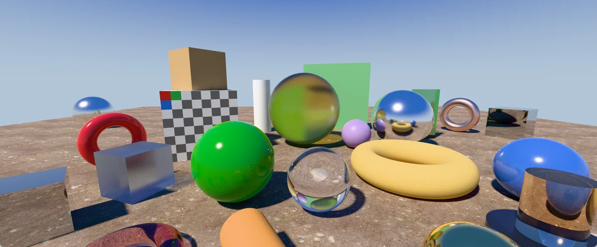
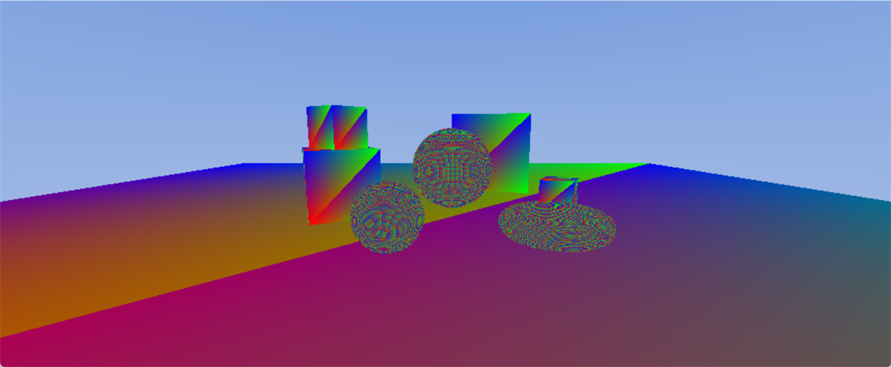
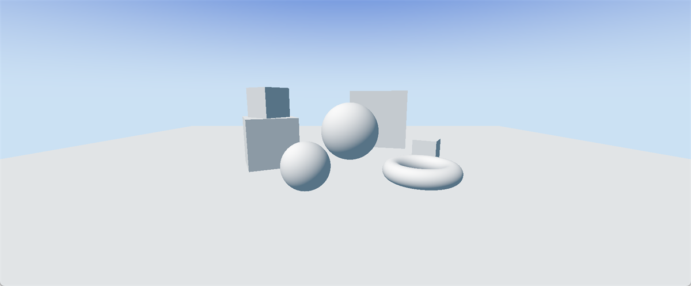
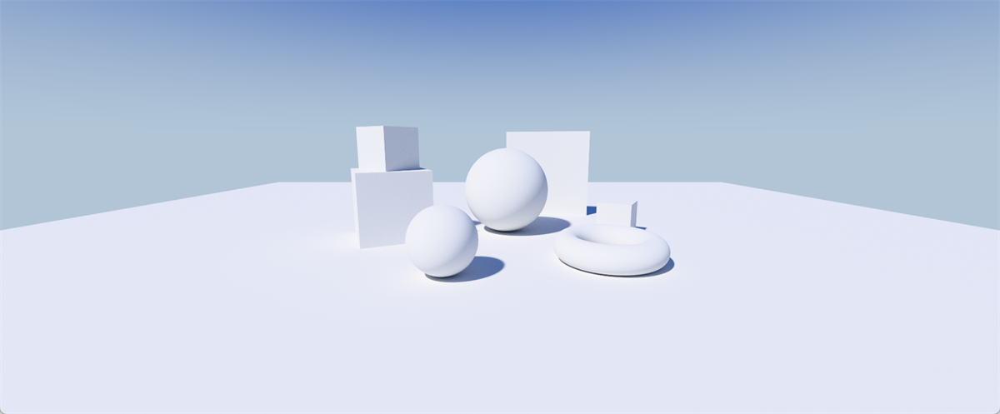
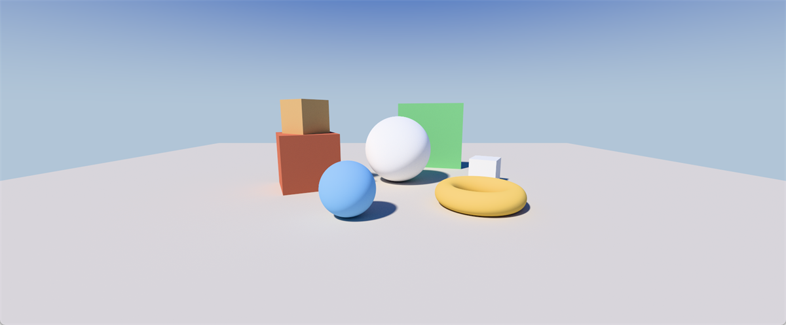
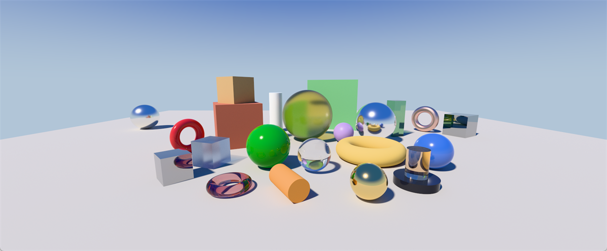
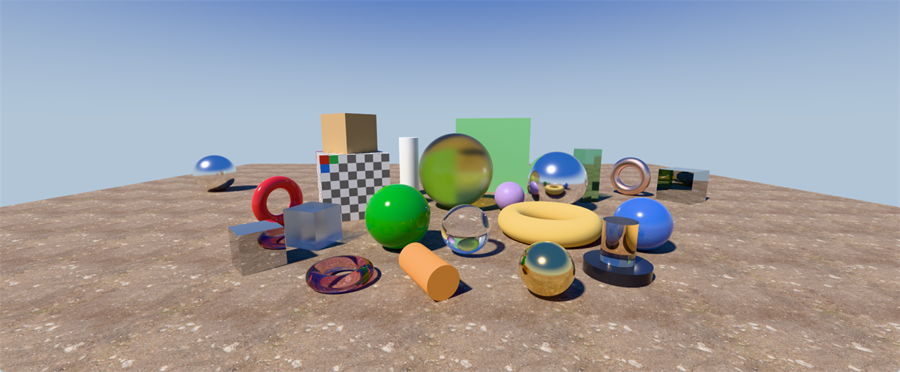

# Vulkan Ray Tracing Shaders

A very basic Monte Carlo path tracer built on two Vulkan extensions. There is no rasterization in it anywhere: every
frame is a single `vkCmdTraceRaysKHR` that traces one more sample per pixel and averages it into the image, so a
still view keeps converging.

## VK_KHR_ray_tracing_pipeline

The renderer is one ray tracing pipeline: a ray generation shader that builds the camera rays and accumulates the
radiance they bring back, a miss shader per ray type, and a hit group per material. Rays are traced against a two
level acceleration structure whose top level is rebuilt each frame from the scene's instances.

## VK_EXT_descriptor_heap

No descriptor sets, no pools, no set layouts. The resources every shader shares are bound by pushing their contents
or their device address, and images live in a descriptor heap and are found by the slot they sit in. Which binding
in a shader reads which resource comes from reflecting the shader's own SPIR-V, so the two sides are matched by the
names the shader declares rather than by a layout the host has to keep in step with it.

## The shaders are plain HLSL

Every shader is ordinary Shader Model 6.3 HLSL, compiled with `dxc -T lib_6_3 -spirv`. There is not a single
`[[vk::...]]` attribute in any of them: resources are declared with nothing but standard `register` bindings, and
what the host needs in order to bind them is read back out of the compiled SPIR-V. It is the same HLSL a DXR
renderer would be written in.

The ray generation shader and the miss shader of each ray type are in
[RayGen.hlsl](source/shaders/RayGen.hlsl), and every material is a module of its own:
[MaterialDiffuse.hlsl](source/shaders/MaterialDiffuse.hlsl),
[MaterialMetal.hlsl](source/shaders/MaterialMetal.hlsl) and
[MaterialGlass.hlsl](source/shaders/MaterialGlass.hlsl).

## Materials are bound through the shader binding table

Every instance owns its hit records in the shader binding table, and a record carries what that instance's material
needs: the constants of its surface shader, the heap slots of its textures, and the addresses of its mesh's vertex
and index buffers. The record also names the hit group, which decides the closest hit shader that runs.

So instances in the same acceleration structure can use entirely different materials — diffuse, glass, metal — each
one a separate shader module with its own set of properties, and several instances can share a material or vary only
in the values their records hold.

## Progression

The first thing the pipeline drew: triangle barycentrics written straight from the ray generation shader.

Vertex and index buffers bound through the shader records, so a closest hit shader can interpolate a normal and
shade with it.

Path tracing with sample accumulation: bounce lighting, soft shadows and a sky, converging while the view holds
still.

A color per instance, carried in its hit record, with the diffuse closest hit shader moved into a module of its own.

Glass and metal: more surface shaders, each with its own hit group, mixed freely across the instances.

Textures loaded from PNG. The slot a texture occupies in the resource heap travels in the hit record like any other
material property.
